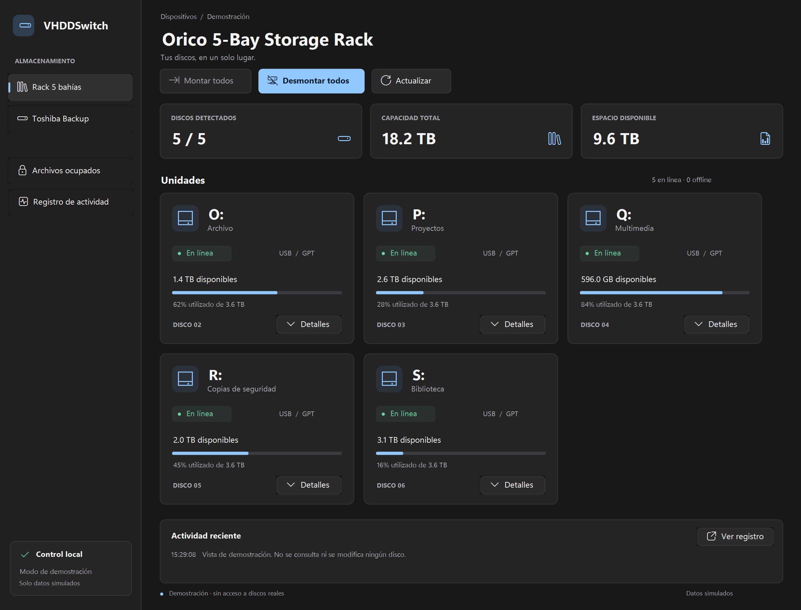

# Documentación de VHDDSwitch

- [Compilar, ejecutar y usar la aplicación](EJECUCION.md)
- [Configurar dispositivos y perfiles](CONFIGURACION.md)
- [Arquitectura, límites y pruebas](DESARROLLO.md)

## Nueva interfaz

Navegación lateral por perfil, tarjetas de unidades, indicadores de capacidad, detalles expandibles y registro de actividad. Usa la barra de ventana de Windows, con modo oscuro y esquinas redondeadas cuando el sistema lo admite. Mantiene el ajuste de ventanas, los controles de minimizar/maximizar y la navegación por teclado.



Esta imagen es una renderización de los controles con datos ficticios; no es una consulta de tus discos ni una captura de la barra de ventana del sistema.

Para revisar el diseño sin acceder al almacenamiento:

Abre [`scripts/Vista-Previa.bat`](../scripts/Vista-Previa.bat) con doble clic, o usa:

```cmd
dist\Windows11\VHDDSwitch.exe --demo
```

Todos los comandos de estas guías se ejecutan desde la raíz del repositorio, salvo que se indique otra cosa.
